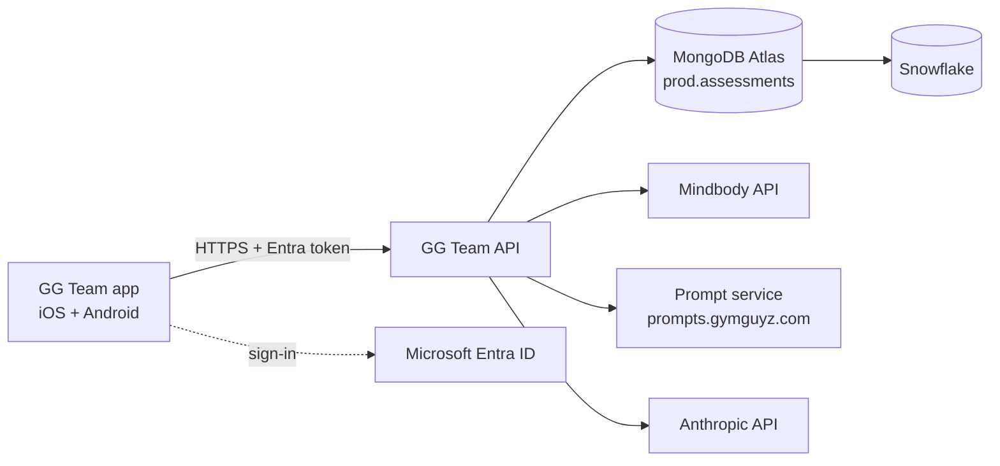

# GG Team Replacement — Build Specification v0.1

Sep 26, 2026 · @Gregg

## 1. Purpose and scope

GYMGUYZ will replace Resourcifi's GG Team app with one it owns: a single Expo (React Native) codebase shipped to both the Apple App Store and Google Play, on a backend GYMGUYZ controls. Trainers keep the same listing and receive the new version as an update.

**Decisions already made**

| Decision | Choice | Why |
| --- | --- | --- |
| Vendor | Replace Resourcifi | Prompt changes, fixes and data access no longer depend on a vendor release |
| Platforms | iOS and Android, one codebase | Heidi tests Android, Hunter tests iOS; both are in production use |
| Framework | Expo (React Native, TypeScript) | Native apps on both stores, cloud builds, over-the-air fixes, reuses prototype logic |
| AI prompts | Served from the GYMGUYZ prompt service | Per gg-prompt-service-SPEC-v0.1 |
| Assessment store | GYMGUYZ MongoDB Atlas | Keeps `prod.assessments` history and existing Snowflake reporting |

**In scope (v1):** trainer sign-in, Mindbody client lookup, new assessments and reassessments across all four types (Adult, Senior, Adaptive, Youth), offline capture, AI trainer brief, assessment history, Snowflake sync.

**Not in scope (v1):** client-facing features, scheduling or booking, payments, per-studio prompt variants, writing anything back to Mindbody beyond what today's app writes (confirm in §7).

The working prototype published in claude.ai (GG Team, September 26, 2026) is the reference for screens, field list and AI behavior. It is not production code.

## 2. Before Resourcifi is told

Complete these quietly first; each gets harder once notice is given. Nothing here requires telling Resourcifi.

- [ ] **Contract review by counsel.** Who owns source code, designs, data and the store listings; notice period; handover and transition-assistance obligations; any non-solicit or IP carve-outs.
- [ ] **MongoDB Atlas control.** Confirm the organization and project (`671be97d88acc62d4fe09aad`) are billed to GYMGUYZ and that a GYMGUYZ account holds Organization Owner. Add a second GYMGUYZ owner.
- [ ] **Full data export.** Snapshot `prod.assessments` (including `assestmentHistory`) and any other collections the app uses. Verify the row count against Snowflake.
- [ ] **Apple account.** Find which developer account publishes GG Team. If it is Resourcifi's, plan an app transfer to a GYMGUYZ account.
- [ ] **Google Play account.** Same check; plan a Play app transfer if needed.
- [ ] **GYMGUYZ store accounts.** Enroll GYMGUYZ as an organization with Apple ($99 a year) and Google Play ($25 once). Both need a D-U-N-S number.
- [ ] **Credentials inventory.** Mindbody API key and source name, Anthropic API key, push notification keys, any other third-party accounts the app uses, and who holds each.
- [ ] **Current stack.** Learn what Resourcifi built in and how it talks to Mindbody, from the contract, the store binaries or a neutral question.

The transfers matter most. A transferred app keeps its listing and installed base, so trainers update rather than reinstall and log in again.

## 3. Architecture

The app talks only to the GG Team API. The API holds every secret and is the only thing that touches Mindbody, MongoDB and Anthropic.

| Component | Technology | Owner |
| --- | --- | --- |
| Mobile app | Expo SDK (current), React Native, TypeScript | GYMGUYZ |
| API | Node.js (TypeScript) on AWS: API Gateway + Lambda, or a single small container on App Runner | GYMGUYZ |
| Sign-in | Microsoft Entra ID (Microsoft 365) | GYMGUYZ IT |
| Assessment store | MongoDB Atlas, existing cluster | GYMGUYZ |
| Warehouse | Snowflake, existing sync path | GYMGUYZ data |
| Prompts | Prompt service (S3 + CloudFront) | GYMGUYZ |
| AI | Anthropic API, key held by the API only | GYMGUYZ |
| Builds and store submission | Expo Application Services (EAS) | GYMGUYZ |

AWS is assumed because the prompt service is specced there; one cloud keeps IAM, logging and billing in one place.

## 4. Mobile app

One Expo project produces both store builds. Screens follow the prototype; the difference is native components, offline storage and real sign-in.

**Stack**

| Concern | Choice |
| --- | --- |
| Language | TypeScript, strict mode |
| Navigation | Expo Router |
| Server data | TanStack Query |
| Offline store | expo-sqlite, with an outbound sync queue |
| Forms | React Hook Form + Zod schemas shared with the API |
| Sign-in | expo-auth-session against Entra ID (PKCE) |
| Camera (posture photos, v1.1) | expo-camera |
| Builds, submission, OTA updates | EAS Build, EAS Submit, EAS Update |
| Crash reporting | Sentry |

**Screens**

1. Sign in
2. My assessments and team assessments, with search
3. Client lookup (Mindbody) or new lead
4. Assessment, eight steps: Client, Health, Joints, Goals and lifestyle, Body, Tests, Movement, Notes
5. Assessment detail, with change-since-last table on reassessments
6. AI trainer brief
7. Settings: studio, sign out, app version, sync status

**Form rules (from UAT feedback)**

- Only client, site and assessment type are required to save. Every other field may be blank.
- Blank is stored as absent, never as 0. "Not attempted" is a value, distinct from blank.
- Reassessment prefills health, joints and goals from the most recent prior assessment.
- The type drives which tests show (Senior and Adaptive hide jump tests; Youth gets its own set, confirm with HQ).

**Offline**

An assessment is written to SQLite on every step change, so nothing is lost if the app closes. Saves queue with a client-generated id and sync when online; the id makes retries safe. The AI brief needs a connection and says so. Mindbody lookup falls back to entering the client manually and matching on sync.

**Distribution**

|  | iOS | Android |
| --- | --- | --- |
| Beta | TestFlight (Hunter) | Play internal testing track (Heidi) |
| Release | App Store, unlisted or public (decide in §12) | Google Play, or managed Google Play private app |
| Hot fixes | EAS Update for JavaScript-only changes | Same |

Over-the-air updates may only fix bugs and adjust behavior already reviewed; new features go through store review on both platforms.

## 5. Backend API

A thin REST API with site-scoped access: a trainer sees only the studios they work at, and every request is checked server-side.

**Sign-in and roles**

Trainers sign in with their Microsoft 365 account through Entra ID. The API validates the token, then looks up the trainer's GYMGUYZ record to get role and sites. Removing someone in Microsoft 365 ends their access on the next token refresh.

| Role | Can |
| --- | --- |
| Trainer | Create and edit own assessments at assigned sites; read all assessments at those sites; generate briefs |
| Owner / manager | Everything a trainer can, for all trainers at their sites; delete assessments |
| HQ admin | All sites; AI on/off per site; read audit log |

Open question: does every trainer have a Microsoft 365 account today? If not, see §12.

**Endpoints (v1)**

| Method and path | Purpose |
| --- | --- |
| `GET /me` | Trainer profile, role, sites, AI enabled per site |
| `GET /clients?site=&q=` | Mindbody client search |
| `GET /clients/{clientPk}/assessments` | History for one client, newest first |
| `GET /assessments?site=&trainer=&cursor=` | List for the home screen |
| `PUT /assessments/{id}` | Create or replace (client-generated id, idempotent) |
| `GET /assessments/{id}` | One assessment |
| `DELETE /assessments/{id}` | Soft delete (owner and HQ only) |
| `POST /assessments/{id}/brief` | Generate AI brief, streamed |
| `GET /config` | Minimum app version, feature flags |

**Rules**

- `trainerPk`, `mboSiteId`, `createdAt` and `isReassessment` are set by the server, never trusted from the app.
- Every write records who, when and what changed in an audit collection.
- `GET /config` returns a minimum supported version, so the API can force an update after a breaking change.

## 6. Data model

New assessments keep the `prod.assessments` document shape so existing Snowflake models, the trainer-brief skill and history keep working. Changes are additive: new fields, never renamed ones.

**Kept as-is (including production misspellings):** `clientPk` (`GG{siteId}{mboClientId}`), `mboSiteId`, `mboClientId`, `trainerPk`, `assessmentType`, `parq.*`, `bodyAssessment.*`, `fitnessAssessment.*`, `finishAssessmentPrompt*`, `assestmentHistory`, `parq.medicalHistory.metobolic`, `parq.goals.trainStarTime`. Renaming these would break every downstream query.

**Added fields**

| Field | Type | Purpose |
| --- | --- | --- |
| `schemaVersion` | int | 2 for documents written by the new app |
| `sourceApp` | string | `gg-team-v2`, to separate new records from Resourcifi's |
| `clientRequestId` | string | Client-generated id; makes offline retries idempotent |
| `priorAssessmentId` | string | The most recent earlier assessment, set by the server |
| `ai.promptId`, `ai.promptVersion` | string | Which prompt produced the brief |
| `ai.model`, `ai.generatedAt`, `ai.basedOnAssessmentId` | string, date | Traceability for every brief |
| `deletedAt`, `deletedBy` | date, string | Soft delete |

**Fixes to legacy traps**

| Legacy behavior | New rule |
| --- | --- |
| Blank numbers stored as `0` (`restingHeartRate`, `waterInOz`, test reps) | Omit the field or store `null`. Readers treat absent and `null` as not recorded. Legacy zeros stay as they are. |
| Body measures stored as strings | Keep the string fields so Snowflake models don't break, and add numeric twins under `bodyAssessment.numeric`, including computed height in inches |
| `feelRestedAfterSleep` defaults to `false` | Nullable; only set when answered |
| `["Other"]` with the real finding in a paired `*Other` string | Keep the shape; the app requires the text when "Other" is picked |
| `score: "None"` for not attempted | Keep, and the app labels it "Not attempted" |
| BMI entered by hand, sometimes wrong | Computed server-side from height and weight |

The prototype's field list maps onto these paths; the mapping table goes in the repo as `docs/field-map.md`.

## 7. Mindbody integration

This is the highest-risk workstream: it depends on API access GYMGUYZ may not hold today. Start it first.

**What the app needs from Mindbody**

| Need | Mindbody data | Direction |
| --- | --- | --- |
| Find the client being assessed | Client search by name, phone or id per site | Read |
| Prefill snapshot | Name, birth date, gender, address (household match only, never displayed) | Read |
| Identify the assessor | Staff record for the signed-in trainer | Read |
| Anything today's app writes back | To confirm with Resourcifi's contract or a traffic capture | Write (TBD) |

**Access**

- Mindbody's Public API needs a developer source name and key, and each studio site must grant that source access. Today those grants likely point to Resourcifi's source.
- Decide early whether GYMGUYZ registers its own source (clean, but every site must re-approve) or takes over Resourcifi's (faster, depends on the contract).
- The API key lives only in the backend. Calls are cached briefly and rate-limited per site to stay inside Mindbody's limits.

**Mapping**

`clientPk` stays `GG{siteId}{mboClientId}`. Trainers map through the existing trainer tables in Snowflake (`Trainer Pk`, `Gg Team User`), so roster reports keep working.

**Fallback**

If Mindbody is unreachable, the trainer enters the client manually. The API matches the record to a Mindbody client on sync and flags any it can't match for an owner to resolve.

## 8. AI trainer brief

The API builds the brief; the app only displays it. GYMGUYZ changes the prompt by editing the prompt service, with no app release.

**Flow**

1. App calls `POST /assessments/{id}/brief`.
2. API checks the site has AI enabled (from the prompt service's site config).
3. API loads the assessment and the most recent earlier one for the same `clientPk`, by `createdAt`.
4. API fetches the current `trainer-brief` prompt document, which carries the template, model and token limit.
5. API strips contact details, shortens the client's name to first name and last initial, drops empty fields, and fills the template.
6. API calls the Anthropic API and streams the text back to the app.
7. API saves the brief with `promptId`, `promptVersion`, `model` and `basedOnAssessmentId`.

**Guardrails carried from UAT and the prototype**

- The current assessment is always the most recent one. The prior one is labeled as prior and used only for change.
- Absent fields are sent as absent. The prompt forbids reporting a result for any test with no input, including balance.
- Family history is labeled as relatives, not the client.
- No diagnosis; conditions become exercise guidance.
- The movement menu uses GREEN, AMBER and RED tags that the app renders as badges.

**Quality loop**

Trainers can rate a brief thumbs up or down with an optional note. Ratings are stored with `promptVersion`, so HQ can compare prompt versions in Snowflake before rolling one out everywhere.

## 9. Snowflake sync and reporting

Reports built on assessments must read the same after cutover. The daily brief, roster health, the Gg Team Assessed field and the trainer brief all depend on this feed.

- Keep the existing Mongo-to-Snowflake path and the `isDataSyncedToSnowflake` flag. Find out who runs it today; if it is Resourcifi, move it to GYMGUYZ before cutover.
- New fields (`sourceApp`, `ai.promptVersion`, `priorAssessmentId`, brief ratings) land as new columns; no existing column changes type or meaning.
- Add a daily reconciliation: Mongo count vs. Snowflake count by site and day, alerting on any gap.
- During the parallel run, `sourceApp` separates old-app and new-app records, so the two can be compared side by side.

## 10. Security, privacy and store compliance

The app holds client health information, so it is built to the standard of a health app even if GYMGUYZ is not a HIPAA-covered entity. Counsel should confirm the obligations.

**Security**

- No secrets in the app. Mindbody, Anthropic and database credentials live in AWS Secrets Manager, readable only by the API.
- TLS everywhere; MongoDB Atlas encryption at rest; IP access list limited to the API.
- Offline data on the phone sits in the app sandbox and is wiped on sign-out.
- Tokens are stored in the platform keychain (expo-secure-store).
- Audit log of every read of a full assessment and every write.
- Least privilege: HQ read-only analytics roles never get write access to assessments.

**Privacy**

- A GYMGUYZ privacy policy covering assessment data, the AI brief, and data sent to Anthropic.
- Contact details never leave the API toward Anthropic. Confirm GYMGUYZ's Anthropic API data-retention terms suit health data.
- A retention rule for former clients, set by counsel.

**Store requirements**

|  | Apple | Google |
| --- | --- | --- |
| Privacy disclosure | App Privacy labels: health and fitness, contact info, identifiers | Data safety form: same categories |
| Account deletion | Required when accounts are created in-app; accounts come from Microsoft 365, so document that | Same |
| Review access | Demo trainer account and a test site for reviewers | Same |
| Health data | Fitness assessment only, no diagnosis claims in the listing | Same |

## 11. Phases, parallel run and cutover

No studio loses the old app until the new one has matched it in production. Durations are planning estimates for one developer working with Claude Code, and assume Mindbody access is settled in phase 0.

| Phase | Work | Gate to move on | Estimate |
| --- | --- | --- | --- |
| 0. Secure | Everything in §2; Mindbody source decision; name the owner | Contract read, export verified, store accounts active | 2–3 weeks |
| 1. Backend | API, Entra sign-in, MongoDB writes, audit log, prompt service hookup | Acceptance tests 1–5 pass against a staging database | 3–4 weeks |
| 2. App | Eight-step form, offline queue, history, brief screen, both platforms | Heidi (Android) and Hunter (iOS) sign off on TestFlight and Play internal track | 4–6 weeks |
| 3. Pilot | One or two studios on the new app, all others on Resourcifi's | Two weeks with no data gaps in Snowflake reconciliation and no P1 bugs | 2–4 weeks |
| 4. Cutover | Store transfer lands; new version released as an update to everyone | 95% of active trainers on the new version | 1–2 weeks |
| 5. Exit | Resourcifi contract ends after overlap | 30 days stable | 30 days |

**Rollback**

- Before cutover: pilot studios switch back to the old app, which keeps working.
- After cutover: the previous store build is resubmitted, or EAS Update rolls back a JavaScript change within minutes. Data stays in the same MongoDB either way, so nothing is lost.

## 12. Acceptance, ownership, cost and open questions

**Acceptance tests**

1. A trainer signs in with Microsoft 365 and sees only their assigned sites.
2. A removed Microsoft 365 account loses access within one hour.
3. An assessment saved with only client, site and type succeeds; blank fields are absent in MongoDB, not 0.
4. An assessment completed in airplane mode syncs once, with no duplicate, when the phone reconnects.
5. A reassessment's `priorAssessmentId` points to the most recent earlier assessment, not the first.
6. The AI brief for a reassessment cites the current assessment's values and reports change against the prior one.
7. A brief for an assessment with no balance test says balance was not tested.
8. Every brief record carries `promptId` and `promptVersion`; changing the prompt document changes the next brief with no app release.
9. Turning AI off for a site hides the brief button there within one minute.
10. The new record appears in Snowflake with `sourceApp = gg-team-v2`, and daily reconciliation shows no gap.
11. The same build passes on a current iPhone and a current mid-range Android phone, including Heidi's reassessment path.

**Ownership**

| Area | Owner |
| --- | --- |
| Product decisions, prompt content | Gregg Bushyeager |
| Code, releases, on-call for outages | To be named (in-house developer or contractor) |
| iOS testing | Hunter Blatz |
| Android testing | Heidi Loiacono |
| Microsoft 365 accounts and Entra app registration | GYMGUYZ IT |

**Running cost (estimates, to confirm)**

| Item | Cost |
| --- | --- |
| Apple Developer Program | $99 a year |
| Google Play developer account | $25 once |
| Expo Application Services | Paid plan; check current pricing for build volume |
| AWS (API, secrets, logs) plus prompt service | Low tens of dollars a month at current volume |
| Anthropic API | Per brief; size from pilot volume |
| MongoDB Atlas, Snowflake | Existing |
| Developer or contractor | The main cost; compare against the Resourcifi contract |

**Open questions**

- [ ] Does every trainer have a Microsoft 365 account? If not, choose email sign-in or add accounts.
- [ ] Public App Store and Play listings, or unlisted / private distribution?
- [ ] Register a new Mindbody source, or take over Resourcifi's?
- [ ] What does today's app write back to Mindbody, if anything?
- [ ] Which Youth tests should the app show?
- [ ] Who runs the Mongo-to-Snowflake sync today?
- [ ] Who owns the code and releases after launch?
